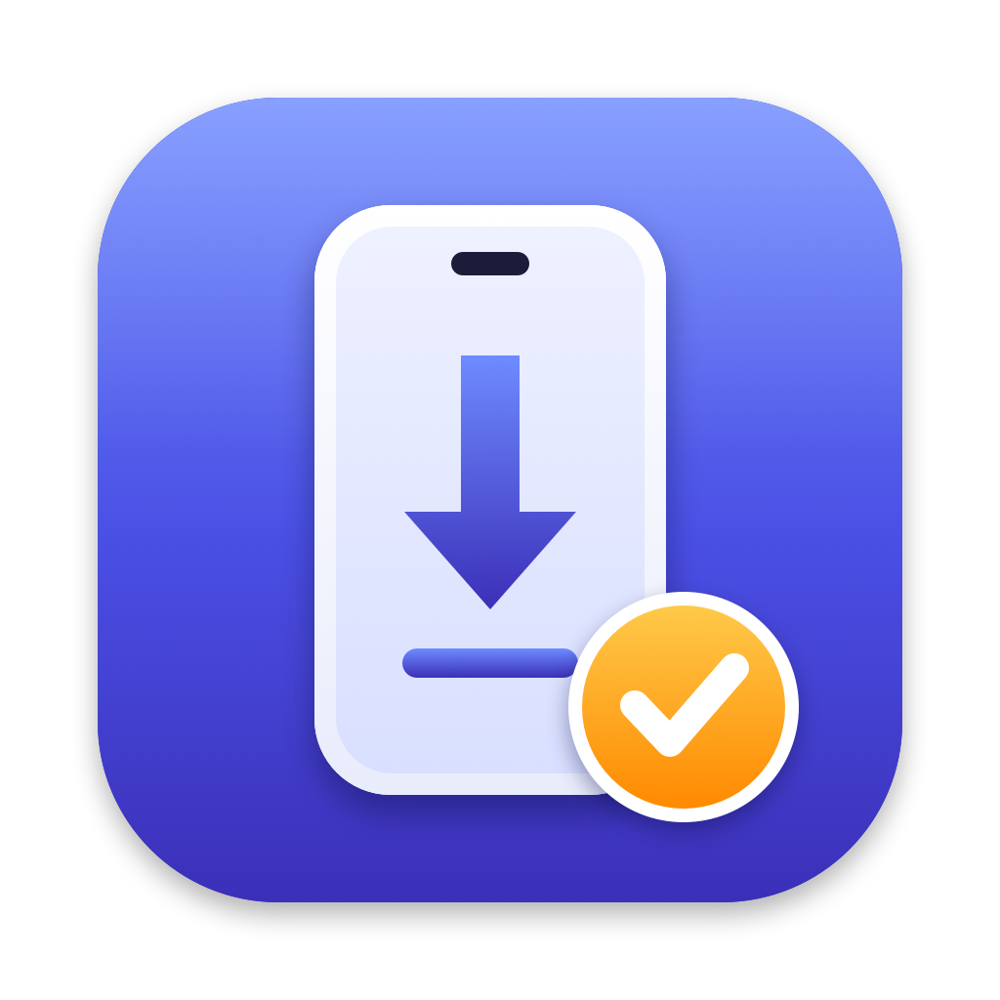

<p align="center"></p>

# IPA 安装器

一个 macOS 小工具：用你自己的开发证书（`.p12` + `.mobileprovision`）重签 `.ipa`，并通过数据线直接装到 iPhone / iPad 上。

- 证书和描述文件只需拖进来一次，之后保存在这台 Mac 上，证书密码存进钥匙串。
- 以后每次只需拖入 `.ipa`、选择设备、点「安装」。
- Bundle ID 自动改成描述文件绑定的 App ID。

## 为什么要改 Bundle ID

很多侧载工具签名时只替换证书，不改 Bundle ID，导致 App 的内部身份（`application-identifier`）和 Bundle ID 对不上。App 看起来能正常打开，但系统会拒绝把文件选择器选中的文件和文件夹交给它，表现为「选完点打开没有反应」。

IPA 安装器签名时会让两者保持一致：

| 描述文件的 App ID | 安装后的 Bundle ID |
|---|---|
| 具体 ID，如 `TEAMID.com.example.app` | 改成 `com.example.app` |
| 通配符 `TEAMID.*` | 沿用安装包原来的 ID |

## 安装

1. 从 [Releases](../../releases) 下载 `IPAInstaller-macOS-v*.dmg`，打开后把「IPA 安装器」拖进「应用程序」。
2. 安装包没有经过 Apple 公证，第一次打开会被拦截。任选一种方法放行：
   - 在「应用程序」里右键点击它，选「打开」，再点「打开」。
   - 或到「系统设置 → 隐私与安全性」，在页面下方点「仍要打开」。
   - 或在终端运行：
     ```bash
     xattr -dr com.apple.quarantine "/Applications/IPA 安装器.app"
     ```

### 运行要求

- macOS 15 或更高版本，Apple 芯片和 Intel 均可。
- 已安装 **Xcode**：安装到设备用的是 Xcode 自带的 `devicectl`。
- 已安装 **OpenSSL 3**：新格式的 `.p12` 只有它能读取。
  ```bash
  brew install openssl@3
  ```
- iPhone 已用数据线连接这台 Mac，并点过「信任此电脑」；iOS 16 及以上需要在「设置 → 隐私与安全性」里打开「开发者模式」。

## 使用

1. 把 `.p12` 证书和 `.mobileprovision` 描述文件拖进窗口，填写证书密码并保存。
2. 把 `.ipa` 拖进窗口，或拖到 Dock 图标上。
3. 选择设备，点「安装」。装好后 App 会自动打开（手机锁屏时只安装）。

三种文件可以一次全部拖进去，会按扩展名自动归位。

安装前会检查：

- 证书和描述文件是否配套。
- 描述文件是否过期。
- 描述文件里是否登记了所选设备。

## 签名流程

1. 用 OpenSSL 3 解开 `.p12`，转成钥匙串能读取的旧格式，导入一个临时钥匙串。临时钥匙串用完即删，不会改动你的登录钥匙串。
2. 解包 `.ipa`，修改 `CFBundleIdentifier`，嵌入描述文件，生成与 App ID 一致的 entitlements。
3. 用 `codesign` 依次签名 `Frameworks` 和主程序。
4. 用 `xcrun devicectl device install app` 安装到设备。

### 限制

- 一份描述文件只覆盖主程序。安装包里的扩展（`PlugIns`、`Extensions`）和手表 App 会被移除。
- entitlements 只包含 App ID、团队 ID、`get-task-allow` 和钥匙串访问组。依赖 App Group、iCloud、推送等能力的 App，相应功能会失效。

## 从源码构建

需要 Xcode 和 [XcodeGen](https://github.com/yonaskolb/XcodeGen)。

```bash
scripts/install.sh   # 构建并安装到「应用程序」
scripts/package.sh   # 打包通用版 dmg 到 dist/
```

图标由 `scripts/draw-icon.swift` 绘制：

```bash
swift scripts/draw-icon.swift Design/icon-1024.png
```
